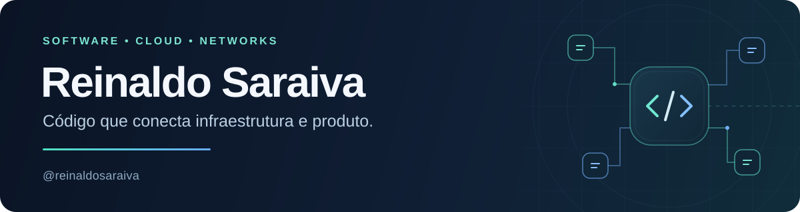

  <a href="https://github.com/reinaldosaraiva">GitHub</a> ·
  <a href="https://macewindu.wordpress.com">Blog</a> ·
  <a href="https://github.com/reinaldosaraiva?tab=repositories">Repositórios</a>

## Olá, eu sou o Reinaldo

Sou **desenvolvedor e arquiteto de cloud e redes**. Trabalho na conexão entre engenharia de software e infraestrutura, criando APIs, automações e ferramentas para simplificar a operação de sistemas.

Meu foco está em **Python e Go**, redes programáveis, observabilidade e **IA aplicada à engenharia**. Gosto de transformar problemas de operação em software que possa ser entendido, testado e evoluído.

### O que construo

- **APIs e ferramentas de backend** para integrar serviços, automatizar tarefas e processar trabalho assíncrono.
- **Automação de infraestrutura e redes** com Linux, cloud, containers e práticas de GitOps.
- **Ferramentas de observabilidade e segurança** para entender sistemas, visualizar regras e validar serviços.
- **Sistemas multiagentes e integrações MCP** para apoiar fluxos de desenvolvimento e revisão de código.

## Projetos em destaque

| Projeto | O que você encontra | Tecnologias |
| --- | --- | --- |
| **[NFTables Analyzer](https://github.com/reinaldosaraiva/nftables-analyzer)** | Análise de regras de firewall com grafos interativos, consultas de tráfego e identificação de conflitos. | Python · FastAPI · Next.js · React Flow |
| **[Naabu API](https://github.com/reinaldosaraiva/naabu-api)** | API assíncrona para descoberta e validação de serviços de rede, com acompanhamento de tarefas. | Go · Naabu · Nuclei · Docker |
| **[GoIOTop](https://github.com/reinaldosaraiva/goiotop)** | Monitoramento de CPU, memória, I/O e processos, com interfaces de terminal e exportação de métricas. | Go · TUI · Prometheus |
| **[MAS Workflow](https://github.com/reinaldosaraiva/mas-workflow-oss)** | Orquestração de agentes de IA para geração, revisão e implementação de código. | Python · MCP · Redis · LLMs |

## Minha stack

| Área | Tecnologias e práticas |
| --- | --- |
| **Desenvolvimento** | Python, Go, FastAPI, APIs REST, PostgreSQL |
| **Cloud e infraestrutura** | Linux, Docker, Kubernetes, KVM, Incus |
| **Redes e segurança** | FRR, BGP, nftables, WireGuard |
| **Automação** | Ansible, NetBox, GitOps, CI/CD |
| **Observabilidade** | Prometheus, Grafana, métricas e logs |
| **IA aplicada** | LLMs, MCP, sistemas multiagentes |

### Como penso engenharia

Arquitetura clara, testes úteis, documentação próxima do código e observabilidade desde o início. Valorizo soluções que facilitem tanto o desenvolvimento quanto a operação.

<strong>English summary</strong>

### Hi, I'm Reinaldo

I'm a **software developer and cloud & network architect** working at the intersection of software engineering and infrastructure. I build APIs, automation and tools that make systems easier to operate.

My focus includes **Python and Go**, programmable networks, observability, and **AI applied to engineering**. My public projects explore firewall analysis, asynchronous network services, system monitoring, and multi-agent development workflows.

I value clear architecture, meaningful tests, practical documentation, and observability from the start.

---

**Software, cloud, redes e IA aplicada.** [Explore outros projetos.](https://github.com/reinaldosaraiva?tab=repositories)
